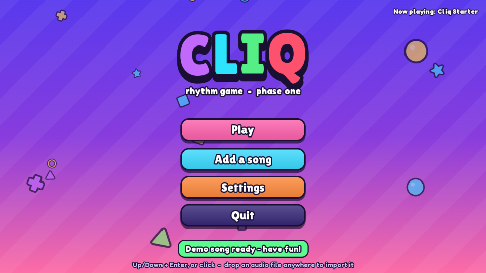
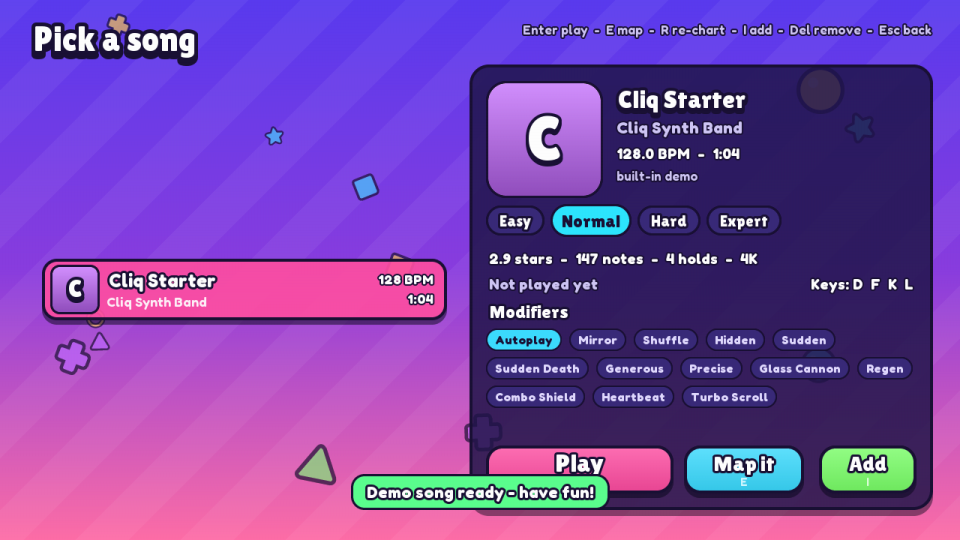
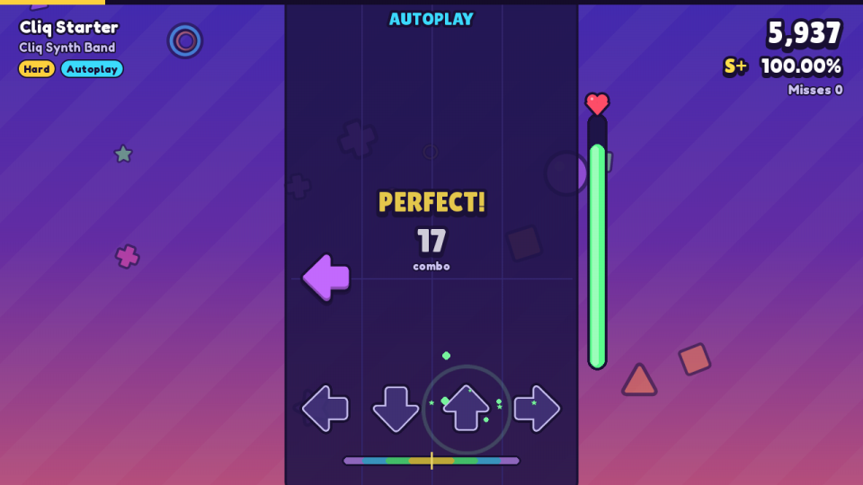
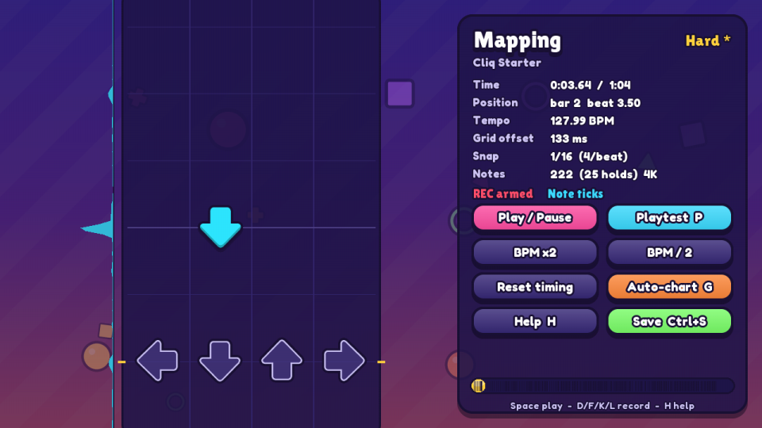

# Cliq

A bright, cartoony rhythm game built with pygame. This is **phase one** of a planned rhythm/roguelike hybrid.

You get a 4-key note highway in the style of rhythm-plus and Friday Night Funkin'. Point it at a YouTube link or any audio file and it finds the BPM and the beat, then auto-charts Easy through Expert so every note lands on the grid. You can also build or fix a chart in the **mapping editor** by playing along with the song.

| | |
|---|---|
|  |  |
|  |  |

## Quick start

Requires Python 3.10+.

```bash
python -m venv .venv
source .venv/bin/activate          # Windows: .venv\Scripts\activate
pip install -r requirements.txt
python run.py                      # or: python -m cliq
```

On first launch the game synthesises a demo track (*Cliq Starter*, 128 BPM) so you can play right away.

`requirements.txt` installs **pygame-ce**, a drop-in replacement for pygame (`import pygame`). Classic `pygame>=2.1` also works. If you already have classic pygame installed, uninstall it first: `pip uninstall pygame`.

## Playing

| Action | Keys |
|---|---|
| Lanes (4K) | **D F K L** (arrow keys also work) |
| Pause / resume | Esc |
| Restart | Ctrl+R in game, or R on the pause/results screen |
| Fullscreen | F11 |
| Screenshot | F12 (saved to `user/screenshots/`) |

In song select, pick a difficulty with **Left/Right** and press **Enter** to play. Toggle modifiers (Mirror, Hidden, Sudden Death, Autoplay...) with the mouse. Charts with 5, 6 or 7 lanes are supported. Every key layout is rebindable in **Settings → Controls**.

Hits are judged PERFECT / GREAT / GOOD / BAD / MISS. Hold notes must be held to their end. Health drains on misses; turn on *No fail* in settings if you just want to practise.

## Adding songs

Use **Add a song** (title screen) or press **I** in song select:

* **YouTube (or any site yt-dlp supports):** paste the link and press *Download*.
* **Audio files:** mp3, ogg, wav, flac, m4a, opus and more. Click *Browse...*, drag the file onto the window, or type its path.
* **Command line:** `python -m cliq import "<link or file>"`. Add `--lanes 6` for a 6-key chart.

Each import downloads the audio if needed, converts it with ffmpeg, finds the beat, and writes charts for every difficulty. A 3-minute song takes a few seconds.

**YouTube requirements.** YouTube now needs two extras besides yt-dlp: `yt-dlp[default]` and a JavaScript runtime. The **`deno`** pip package is the easiest runtime, and both are in `requirements.txt`. Node or Bun on your PATH also work. If downloads start failing, update yt-dlp first: `pip install -U "yt-dlp[default]"`.

**ffmpeg.** A system ffmpeg is used if present; otherwise the binary bundled with `imageio-ffmpeg` is used.

### How the auto-sync works

All analysis code is plain numpy and lives in `cliq/analysis/`:

1. **Onsets.** A log-mel *spectral flux* envelope marks every attack. A measured bias correction makes onset times accurate to about 1 ms. Separate low, mid and high bands tell kicks, snares/vocals and hats apart.
2. **BPM.** Autocorrelation with a tempo prior gives a first guess. The tempo is then refined by finding the beat length that lines up every onset in the song at the same phase, accurate to about 0.01 BPM. The grid offset comes from the same fit.
3. **Tempo drift.** If the constant grid drifts out of sync anywhere (live drummers, tempo changes), the analyser switches to a dynamic-programming beat tracker and uses its beats as a variable grid.
4. **Downbeats.** Kick on 1, backbeat on 2 and 4, and new sections starting on a bar line decide where measures start.
5. **Charting.** Onsets snap to the grid. Notes are picked per measure by salience and metrical weight, up to a density budget for the difficulty, so quiet parts get fewer notes than choruses. Holds go on sustained melody notes. Lanes follow the melody's pitch contour, lean kicks left and hats right, avoid fast same-lane "jacks", and keep both hands busy.

The tests check the analyser against synthetic songs with known BPM, offset, swing/jitter and tempo drift (`tests/test_analysis.py`). On those, beat positions land within a few milliseconds.

## Mapping mode (editor)

Open it from song select with **E**. Pick the difficulty first; choosing an empty slot starts a blank chart.

**Map by playing:** press **Space** (or **Enter**, if Space is one of your lane keys) to play. Tap your lane keys in time with the music. Taps become notes, long presses become holds, and everything snaps to the grid. Recording over an existing chart only adds notes where none exist yet.

| Keys | What they do |
|---|---|
| Left / Right | Snap finer / coarser (1/4 ... 1/64) |
| Up / Down / mouse wheel | Step one snap line (Ctrl+wheel zooms) |
| PgUp / PgDn, Home / End | Jump a measure / to the start or end |
| Lane keys while paused | Toggle a note at the playhead |
| Mouse | Click to add or remove a note, drag to draw a hold, right-click to delete |
| R / M / N | Recording on/off / metronome / note ticks (hear when notes pass the line) |
| `-` / `=` | BPM down/up by 0.1 (Shift: 1, Ctrl: 0.01) |
| `[` / `]` | Shift the grid 5 ms earlier/later (Shift: 1 ms) |
| T | Tap tempo (tap 8+ times on the beat) |
| B | Make the beat at the playhead a bar line |
| G | Re-run the auto-charter for this difficulty |
| Delete / Shift+Delete | Clear this measure / clear all notes |
| Ctrl+Z / Ctrl+Y | Undo / redo |
| P or F5 | Playtest from the playhead |
| Ctrl+S | Save |

The left edge shows the song's onset strength, so you can see where the hits are. **BPM x2 / 2** fixes half-time or double-time detections, and *Reset timing* restores the detected grid.

## Latency

The game does the following on its own:

* Opens the mixer with a small buffer (512 samples = 11.6 ms; adjustable in Settings → Audio).
* Runs the loop at a high frame cap with VSync off by default. A frame takes about 3 ms at 720p, so input is checked every few milliseconds.
* Timestamps key presses with a high-resolution clock when they are read, not at the next frame.
* Plays hit sounds instantly on reserved mixer channels.
* Runs a song clock that follows the sound card's sample position, gently correcting drift without visible jumps.
* Pauses Python's garbage collector while a song plays.

You can do the rest:

* **Calibrate once:** Settings → Audio → *Calibrate offset*. Tap along to the clicks and the median of your taps becomes your audio offset.
* After a song, the results screen shows your average timing. If you are consistently early or late, press **O** to fix the offset in one click.
* Prefer wired headphones; Bluetooth adds 100–250 ms. Keep VSync off. If you hear crackling, raise the audio buffer.

## Customising & modding

Everything is plain files.

| What | Where |
|---|---|
| Your settings | `user/settings.json` (or the in-game menu). Set `"resolution": [1920, 1080]` for crisper art on big screens |
| Timing windows, scores, health, grades | `data/judgement.json` |
| Auto-chart difficulty (density, subdivisions, chords, holds) | `data/difficulties.json` |
| Colours, fonts, lane colours/arrow directions per key count | `data/theme.json` |
| Note art | PNGs in `assets/skins/<arrows\|circles\|bars>/`, see [`assets/skins/README.md`](assets/skins/README.md) |
| Sounds | `assets/sfx/<name>.wav` (`hit`, `tick`, `ui_select`, ...) |
| Gameplay modifiers / items | any `.py` file in `mods/`, see [`mods/example_mods.py`](mods/example_mods.py) |
| Songs and charts | `songs/<song>/` (`song.json`, `audio.ogg`, `charts/*.json`) |

A modifier can change the rules (timing windows, health, score multiplier, scroll speed), rewrite the chart (mirror, shuffle, add or remove notes), react to every hit or miss, block combo breaks, fade notes, and show HUD text. These are the hooks roguelike items will use. The two example mods (*Heartbeat*, *Turbo Scroll*) show up in song select automatically.

Set the `CLIQ_HOME` environment variable to keep songs and settings outside the project folder.

[`docs/architecture.md`](docs/architecture.md) has the code tour and the plan for phase two (roguelike runs, more game modes).

## Development

```bash
pip install -r requirements.txt
python -m pytest            # analysis, charting, gameplay, song clock, import, headless UI flows
python -m cliq analyze song.mp3   # print detected BPM, offset and chart stats
```

The UI tests run headless (`SDL_VIDEODRIVER=dummy`, `SDL_AUDIODRIVER=dummy`).

## Credits

* Fonts: [Fredoka](https://github.com/hafontia/Fredoka-One) and [Lilita One](https://fonts.google.com/specimen/Lilita+One), SIL Open Font License (see `assets/fonts/`).
* All art and sounds are generated procedurally in code.
